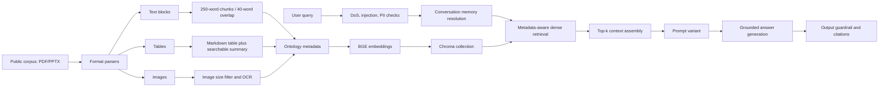
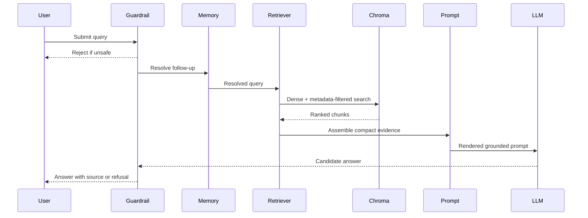

# Part A HLD and LLD

## High-level design

## Low-level modules

| Module | Responsibility | Interface |
|---|---|---|
| `corpus_inventory.py` | Counts documents, pages, tables, images | `inventory() -> list[dict]` |
| `pilot_ingestion.py` | Parses and embeds corpus | Environment flag `PART_A_INGEST_ALL=1` |
| `ontology.yaml` | Metadata vocabulary and filters | YAML configuration |
| `conversation_memory.py` | Resolves follow-up questions | `resolve_follow_up(question) -> str` |
| `prompts.py` | Renders prompt variants | `render(name, question, evidence, modality)` |
| `part_a_evaluate.py` | Retrieves and measures golden-set cases | CLI `--k`, `--repeat` |

## Sequence: one query

## Metadata and interfaces

Every chunk carries `doc_id`, `title`, `tool`, `doc_type`, `topic`, `year`, `source_url`,
`sensitivity`, `modality`, `page`, and `table_id`. The public-data filter is mandatory.

## Error handling

- PDF/PPTX parse errors are written to the ingestion log and processing continues.
- Missing OCR engines return an empty OCR result; text/table extraction remains available.
- Chroma write failures stop embedding with a visible process error.
- Unsafe queries are rejected before retrieval.
- Missing retrieval evidence produces a refusal instead of an unsupported answer.

## Constraint mapping

| Constraint | Design decision | Evidence |
|---|---|---|
| FR1 at least 100 documents | Ingest all PDF/PPTX excluding duplicate originals | Inventory summary |
| FR2 text/table/image search | Separate parsers and Chroma modality metadata | Golden-set coverage |
| FR3 P95 under 90 seconds | Chroma top-k retrieval plus compact context | Latency table |
| FR4 guardrails under 6 seconds | Regex and length checks before retrieval | Guardrail timing |
| FR5 self-improvement | Prompt-iteration log and held-out evaluation | Iteration CSV |
| NFR1 consistency | Deterministic seed and repeated queries | Consistency result |
| NFR2 token optimisation | 250-word chunks, top-k evidence, ontology filters | Prompt benchmark |
