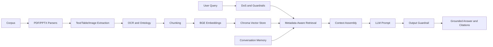

# PCAM ZG516 - Assignment 2 - Part A

## Title and Group Details
Add names, IDs, and group number.

## Abstract
Summarise the corpus, system, retrieval design, evaluation, and main result.

## 1. Anchor
### Domain and target user
Define the Snowflake/Azure data-platform research scenario and intended users.

### Corpus
Use `corpus_inventory.csv` and `corpus_inventory_summary.json`.
The project must be based on public, non-confidential documents.

### Why retrieval
Explain that the documents vary by modality and that fine-tuning would not provide source-citable updates.

## 2. Preprocessing
Explain PDF/PPTX parsing, OCR, table extraction, image extraction, chunking (250 words, 40 overlap), metadata, and BGE embeddings.

## 3. Retrieval and Memory
Document Chroma, metadata filters, dense retrieval, text/table/image fusion, and conversation memory.

## 4. HLD

## 5. LLD
Describe modules, interfaces, schemas, sequence, and failure handling. Include the ontology and guardrail files.

## 6. Prompting
Attach `prompt_ablation.csv`, `self_improvement_log.csv`, guardrail tests, and the final prompt.

## 7. Evaluation
Attach `golden_set.jsonl`, `evaluation_per_case.csv`, and `evaluation_summary.json`.
Provide Recall@k, MRR, answer coverage, latency P50/P95, and 5-run consistency.

## 8. Constraints
Use a table mapping FR1-FR5 and NFR1-NFR2 to implementation and measured evidence.

## 9. Failure Analysis
Complete `failure_cases_template.md` with at least three real failures.

## 10. Lessons Learned
Include individual member lessons and individual contribution confirmation.
